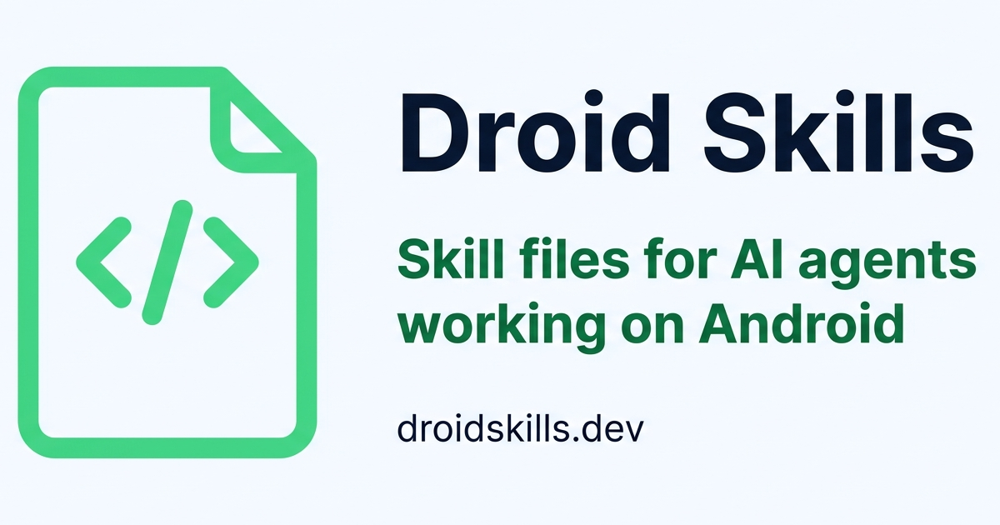

# Droid Skills

Skill files for AI agents working on Android — verified, dated corrections
to stale model knowledge, served over plain HTTP as SKILL.md files.
Public domain (CC0 1.0). Live at https://droidskills.dev — the repo name
itself is TLD-agnostic (`droidskills`; owner ruling 2026-11-10).

- [AGENTS.md](AGENTS.md) — the working rules (mission, hard rules, commands)
- [HANDOFF.md](HANDOFF.md) — the historical decision log

## The site

- `/SKILL.md` — the root index skill AND the full directory of all skills
- `/<skill>/SKILL.md` — one agent-consumed skill file per topic
- `/skills/` — the full shelf (human page; owner ruling 2026-11-10)
- `/<skill>/` — the human page for one skill
- `/llms.txt` — the machine-readable catalog
- `/about` — the project, the verification discipline, the ground rules

Brand: the green robot (`apps/web/public/favicon.svg`,
`apps/web/src/components/Robot.astro`), Orbitron 800 display font
(self-hosted woff2, SIL OFL 1.1 — `apps/web/public/fonts/Orbitron-OFL.txt`),
Android green `#3ddc84` on cool paper, zero-JavaScript CSS animations
(the site ships no client JS at all — AGENTS.md rule 4).

## Commands

| Task       | Command      |
| ---------- | ------------ |
| Install    | `pnpm install` |
| Dev server | `pnpm dev`     |
| Type-check | `pnpm check`   |
| Test       | `pnpm test`    |
| Build      | `pnpm build`   |

## Contributing

Contributions are a first-class part of this project — wrong-fact reports,
new skill proposals, fixes, tooling. Read [CONTRIBUTING.md](CONTRIBUTING.md)
first: the bar is the verification discipline (every dated fact names its
retrieval date and source page), and contributions are dedicated to the
public domain under CC0 1.0 (full legal text: [LICENSE](LICENSE)).
Conduct: [CODE_OF_CONDUCT.md](CODE_OF_CONDUCT.md).
